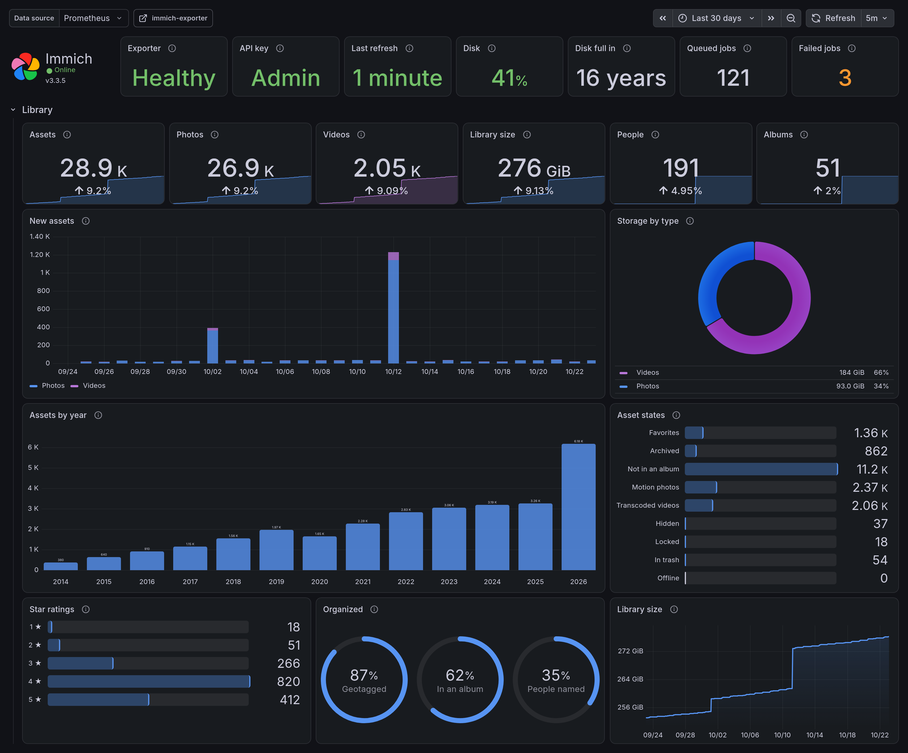
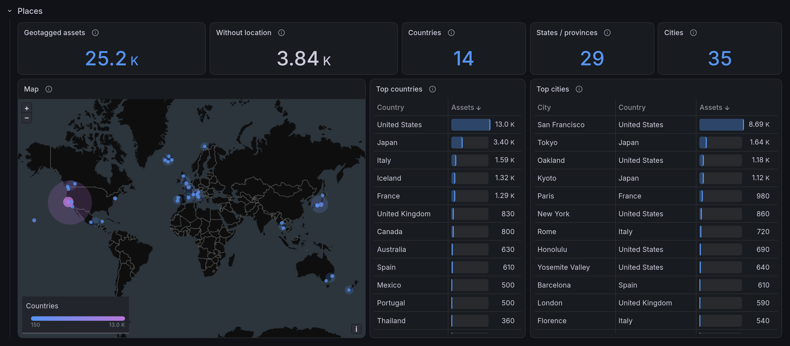
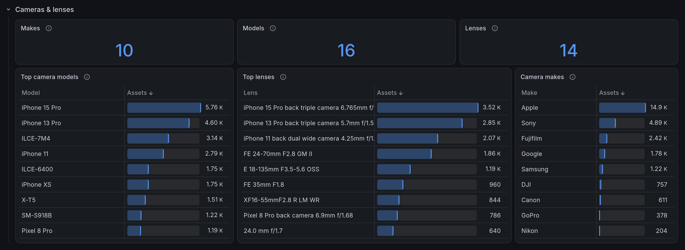
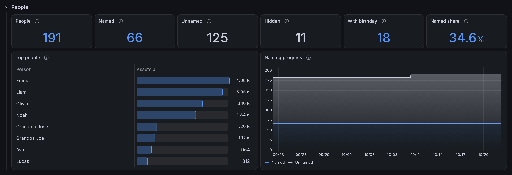
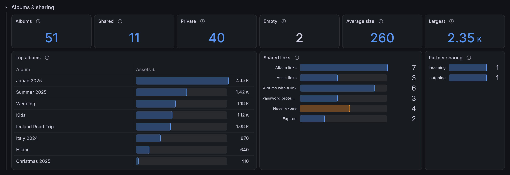
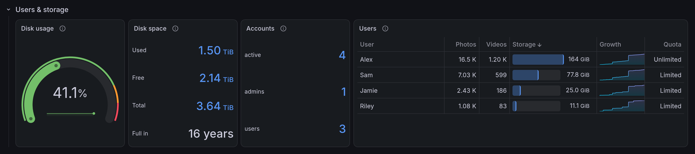
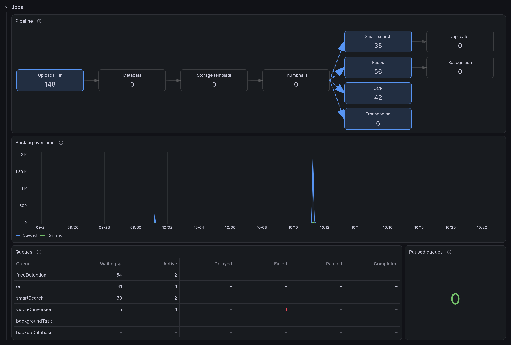
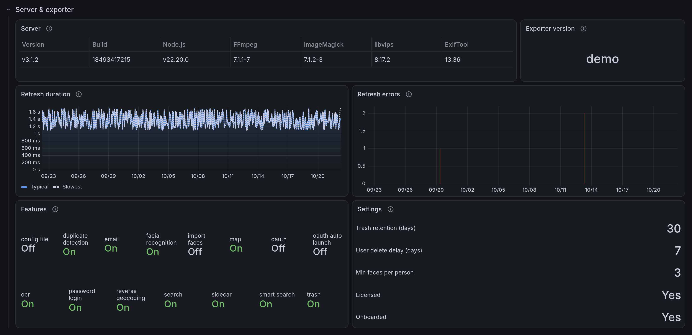
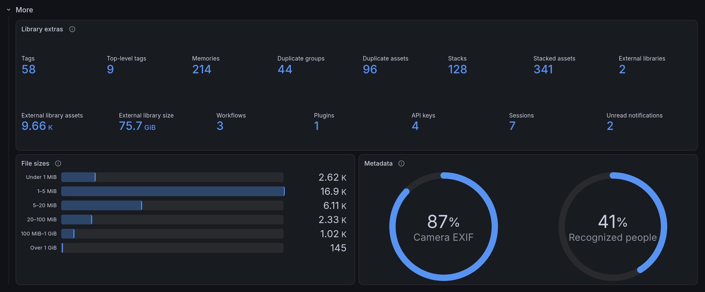

# immich-exporter

[](https://github.com/moond4rk/immich-exporter/actions/workflows/ci.yml) [](https://codecov.io/gh/moond4rk/immich-exporter) [](https://github.com/moond4rk/immich-exporter/releases/latest) [](LICENSE)

A Prometheus exporter for what's inside your [Immich](https://immich.app) library: assets, cameras, places, people, storage, jobs and backups. It comes with a Grafana dashboard and alert rules.

Immich's built-in telemetry measures how the server performs; this exporter reports what the library holds. It reads the Immich API with an API key and never touches the database.

<picture>
  <source media="(prefers-color-scheme: light)" srcset="docs/images/dashboard-overview-light.webp">
  
</picture>

<details>
<summary>More screenshots</summary>

<picture>
  <source media="(prefers-color-scheme: light)" srcset="docs/images/dashboard-geography-light.webp">
  
</picture>

<picture>
  <source media="(prefers-color-scheme: light)" srcset="docs/images/dashboard-cameras-light.webp">
  
</picture>

<picture>
  <source media="(prefers-color-scheme: light)" srcset="docs/images/dashboard-people-light.webp">
  
</picture>

<picture>
  <source media="(prefers-color-scheme: light)" srcset="docs/images/dashboard-albums-light.webp">
  
</picture>

<picture>
  <source media="(prefers-color-scheme: light)" srcset="docs/images/dashboard-users-light.webp">
  
</picture>

<picture>
  <source media="(prefers-color-scheme: light)" srcset="docs/images/dashboard-jobs-light.webp">
  
</picture>

<picture>
  <source media="(prefers-color-scheme: light)" srcset="docs/images/dashboard-server-light.webp">
  
</picture>

<picture>
  <source media="(prefers-color-scheme: light)" srcset="docs/images/dashboard-more-light.webp">
  
</picture>

The screenshots show a synthetic demo library, generated by [`grafana/demo`](grafana/demo).

</details>

## Features

- **100+ metrics** on library content: assets by type, year, rating and file size, cameras and lenses, countries and cities, people, per-user storage and quota, albums and sharing, and every job queue.
- **A Grafana dashboard** with 70+ panels and a world map, and **alert rules**. Both are tested on Prometheus and VictoriaMetrics.
- **Immich's upkeep**: what its integrity checks found, its database backups, maintenance mode and available updates.
- **Light on your server**: counts refresh every 2 minutes, and the heavier breakdowns every 15.
- **A small, signed image** for amd64 and arm64 that runs as non-root.

## Quick start

1. In Immich, create an API key under **Account Settings → API Keys**. An admin account with the `all` permission gets every metric.
2. Add the exporter to the `docker-compose.yml` that runs Immich, then run `docker compose up -d`. Metrics appear at `http://localhost:8000/metrics`.

   ```yaml
   services:
     immich-exporter:
       image: ghcr.io/moond4rk/immich-exporter:latest
       environment:
         IMMICH_HOST: immich-server
         IMMICH_API_TOKEN: your-api-key
       ports:
         - "8000:8000"
       restart: unless-stopped
   ```

3. Add a scrape job to Prometheus, pointing at the host that runs the exporter:

   ```yaml
   scrape_configs:
     - job_name: immich-exporter
       static_configs:
         - targets: ["your-docker-host:8000"]
   ```

4. In Grafana, import [`grafana/dashboard.json`](grafana/dashboard.json) under **Dashboards → New → Import**, and pick your Prometheus data source.

No Prometheus or Grafana yet? [`deploy/docker-compose.yml`](deploy/docker-compose.yml) starts the exporter, Prometheus and Grafana, with the dashboard and alerts already set up. Grafana then runs on http://localhost:3000 (admin / admin).

```sh
cp deploy/.env.example deploy/.env   # set IMMICH_API_TOKEN
docker compose -f deploy/docker-compose.yml up -d
```

The exporter also runs as a binary from the [releases page](https://github.com/moond4rk/immich-exporter/releases), or on Kubernetes with [`deploy/kubernetes.yaml`](deploy/kubernetes.yaml).

## Configuration

Most setups need only a few environment variables:

| Variable | Default | Description |
| --- | --- | --- |
| `IMMICH_HOST` | `localhost` | Immich server host |
| `IMMICH_PORT` | `2283` | Immich server port |
| `IMMICH_BASE_URL` | — | Full API URL including `/api`, such as `https://photos.example.com/api`; replaces host and port |
| `IMMICH_API_TOKEN` | — | The API key; `IMMICH_API_TOKEN_FILE` reads it from a file instead, such as a mounted secret |
| `SCRAPE_INTERVAL` | `2m` | How often the counts refresh |
| `BREAKDOWN_INTERVAL` | `15m` | How often cameras, places, people, duplicates and stacks refresh |
| `COLLECT_PEOPLE` | `false` | Asset counts per person, at one API call per person |

Every setting is also a command-line flag and a YAML key: see [docs/configuration.md](docs/configuration.md).

## Metrics

The series cover the server and the exporter's own health, integrity checks and backups, assets, cameras, places, people and users, albums and sharing, and job queues. [docs/metrics.md](docs/metrics.md) lists them by group, explains what a non-admin key can see, and shows how to add Immich's own performance metrics.

## Alerts

[`deploy/alerts.yml`](deploy/alerts.yml) has alert rules for, among others, Immich or the exporter going down, a failing or stalled job queue, a filling library volume, integrity-check findings and a stale database backup. Load it with `rule_files` in Prometheus, as a `PrometheusRule` with the Prometheus Operator, or with `vmalert -rule`.

## Contributing

See [CONTRIBUTING.md](CONTRIBUTING.md). Report vulnerabilities as described in [SECURITY.md](SECURITY.md), and don't expose `/metrics` publicly: it carries user, people and album names and places.

## License

[Apache-2.0](LICENSE). An unofficial community project, not affiliated with or endorsed by the Immich project.
